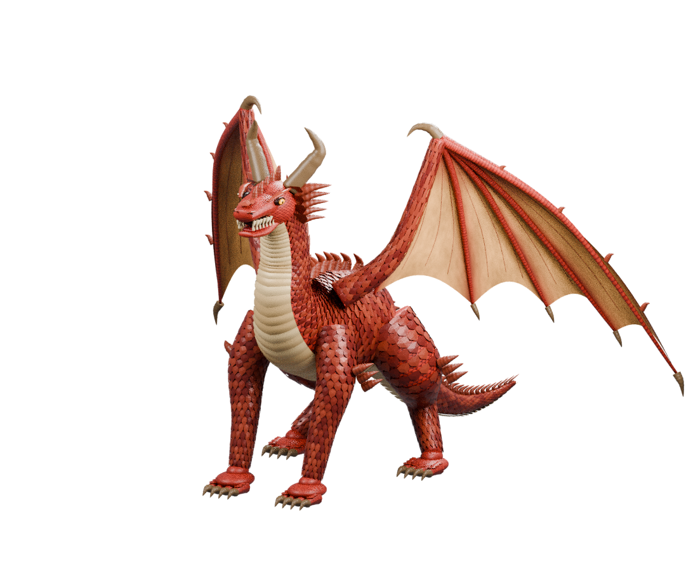

# Model3d

## Crimson Dragon v1

Model rồng đỏ dựng bằng Blender, có bốn chân, hai cánh màng và rig xương. Đây là **bản v1 với thiết kế đầu ban đầu**.

**[Tải model GLB](./crimson_dragon_v1.glb?raw=1)**

File `crimson_dragon_v1.glb` đã nhúng mesh, vật liệu, texture, skin và hoạt ảnh; không cần tải texture riêng.

- 214.004 tam giác, 11 mesh, 20 vật liệu.
- 55 xương, gồm 26 xương cho hai cánh; có xương cổ, hàm, bốn chân và đuôi.
- Bốn texture PNG 2048 × 2048 đã nhúng.
- Đơn vị mét; GLB dùng trục Y lên, +Z trước.

| Hoạt ảnh | Thời lượng | Nội dung |
| --- | --- | --- |
| `Idle` | 4 giây | Cử động nhẹ ở cổ và đầu. |
| `Wing_Display` | 2,4 giây | Cánh và các ngón đỡ cánh cử động. |
| `Tail_Sway` | 4 giây | Đuôi đung đưa. |
| `Roar` | 2 giây | Hàm mở rồi đóng, không kèm âm thanh. |

Di chuyển và đổi tỉ lệ toàn bộ scene chứa mesh và skeleton khi tích hợp vào game. Các clip mẫu chưa bao gồm đi, chạy hoặc chu kỳ bay đầy đủ. Chưa có LOD và collider.

File đã được kiểm tra bằng Khronos glTF Validator với 0 lỗi, 0 cảnh báo. Thông số và SHA-256 nằm trong [crimson_dragon_v1.json](crimson_dragon_v1.json).
